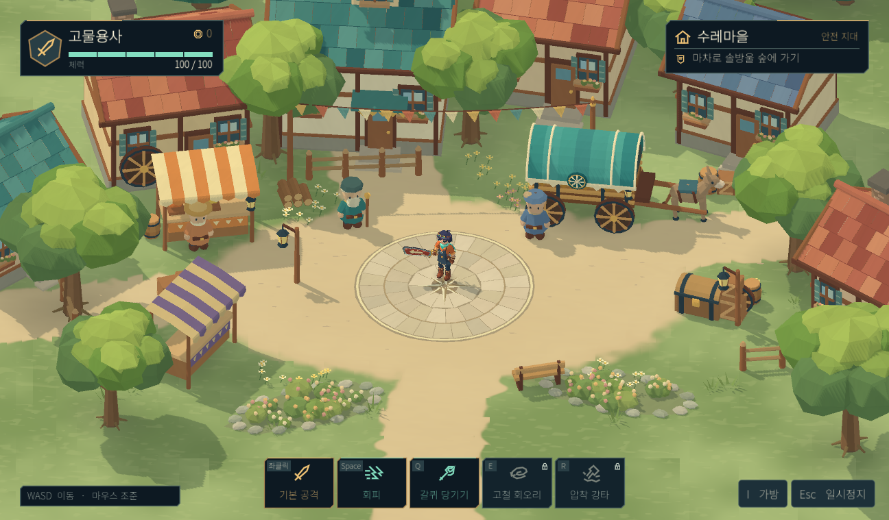

# 고물용사 · Garbage Hero

수레마을에서 출발해 버려진 장비 세 자루를 새 무기로 만드는 2.5D 액션 RPG다. 숲에서 두 번째 덫뿔사슴을 잡으면 수레등 고목왕이 나타난다. 고목왕을 쓰러뜨리고 마을로 돌아오면 사막행 마차가 열린다.

### 0.2.0에서 플레이하기

- 적을 처치해 경험치를 얻는다. 레벨이 오르면 **K**로 성장 화면을 열어 능력치 3점과 스킬 포인트 1점을 배분한다. 힘은 공격력, 활력은 최대 체력, 민첩은 치명타율을 올린다. 배운 기술은 최대 5등급까지 키우고 Q/E/R에 자유롭게 배치할 수 있다.
- **I**에서 무기·갑옷·방패·신발·투구·반지·목걸이를 장착한다. 검이나 메이스에는 방패를 함께 쓸 수 있다. 활·지팡이·창은 두 손을 사용한다. 활의 화살과 지팡이의 마법탄은 멀리 있는 적에게 닿는다.
- 필드마다 128×112m 구역에 여러 경로와 명소 네 곳이 있다. **M**으로 길을 확인한다. 상설 상인은 기본 장비 11종, 이동상인은 방문 지역 장비 3종을 판매한다. 촌장의 의뢰 목록에서 성장·장비·탐험 진행도와 수령할 보상을 볼 수 있다.
- 0.1.0 슬롯으로 시작하면 기존 장비와 노선을 이어받고 레벨 1부터 성장한다. 새 저장은 별도 파일명을 사용한다. 기존 설정에서 K를 다른 동작에 할당했다면 HUD에 표시된 성장 단축키를 사용한다.

[스킬 트리](docs/media/skill-tree.png) · [일곱 장착 부위](docs/media/equipment.png) · [지역 지도](docs/media/field-map.png) · [상점 상품](docs/media/shop.png)

## 실행

**게임만 실행하려면 최신 릴리즈에서 운영체제에 맞는 x86_64 패키지를 받는다.** Windows에서는 ZIP을 풀고 `GarbageHero.exe`를 실행한다. Linux에서는 `.tar.gz`를 푼 뒤 `./GarbageHero.x86_64`를 실행한다. 실행 파일과 `GarbageHero.pck`는 같은 폴더에 둔다. [릴리즈 다운로드](https://github.com/Yupkidangju/garbage_hero/releases/latest)

Windows에서 [Play.cmd](Play.cmd)를 실행하면 Godot가 필요한 에셋을 임포트하고 게임 창을 연다. Godot 실행 파일은 `GODOT_PATH` 또는 PATH의 `godot.exe`를 사용한다. 에디터에서는 프로젝트를 가져온 뒤 **F5**로 시작한다. [Godot 프로젝트](game/project.godot)



```powershell
godot --headless --path game --import
godot --path game
```

**WASD**로 걷고 마우스로 조준한다. **왼쪽 클릭**으로 현재 무기의 기본 공격을 하고 **Space**로 회피한다. 마을 오른쪽 위 마차로 걸어가 **F**를 누르면 쉬움 숲을 선택할 수 있다. **M**은 지도, **I**는 가방, **K**는 성장·기술 배치, **Esc**는 설정이다.

숲의 흔적이 12에 닿으면 중간보스가 나타난다. 처치한 횟수와 떨어진 전리품은 귀환 후에도 보존된다. 귀환하려면 필드 입구 표석에서 **F**를 누른다. 게임은 Windows의 `%APPDATA%\GarbageHero\save`에 진행을 자동 저장한다.

| 문서 | 읽을 내용 |
| --- | --- |
| [게임 기획서](spec.md) | 여섯 필드의 몬스터, 네 난이도, 보스 재출현, 장비 합성과 드롭 확률 |
| [전투·화면·아트 설계](designs.md) | 조작과 기술별 타이밍, 마을·인벤토리 화면, Blender 모델과 리깅의 품질 기준 |
| [제작 계획](tasks/plan.md) | 첫 플레이 범위, Godot MCP 작업 순서, 단계별 검증과 성능 목표 |
| [구현 체크리스트](tasks/todo.md) | 작업별 선행 조건, 산출물과 통과 조건 |
| [구현·검증 기록](IMPLEMENTATION_SUMMARY.md) | 실제 실행 경로, 모듈 연결, 검증 결과와 남은 항목 |
| [빌드·CI/CD 가이드](BUILD_GUIDE.md) | 두 플랫폼의 빌드 명령, 패키지 검증, 태그로 릴리즈하는 방법 |

제작 환경은 Godot `4.7.2.stable.official.ed1daf0bf`와 Blender `5.2.1 LTS`다. 한글 표시에 사용하는 Noto Sans KR의 라이선스는 [OFL](game/assets/fonts/OFL.txt)에 있다.

## 라이선스

Copyright 2026 yupkidangju@gmail.com. 프로젝트 자체 소스와 에셋에는 Apache License 2.0을 적용한다. Godot 엔진과 그 구성요소, Noto Sans KR의 라이선스 고지는 다운로드 패키지에도 포함한다. [LICENSE](LICENSE) · [NOTICE](NOTICE)
